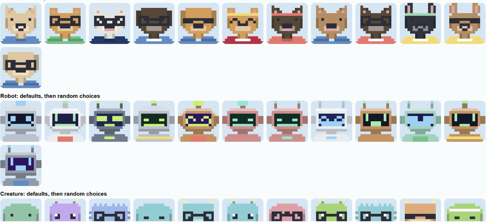

# 🌵 Sonoran Hot Data

**An adaptive classroom prototype for student-centered lesson design, customizable avatars, and AI-assisted instruction.**

**[🎮 Follow the click-by-click demo](DEMO_GUIDE.md)** · **[🧪 Testing notes](docs/TEST_CASES.md)** (in the application repository)

> **Prototype scope:** The primary demonstration is student avatar customization and teacher-side personalized lesson creation and preview. Additional navigation screens illustrate a broader platform and vary in completeness. Teacher-generated lessons are previewed locally; automatic assignment, durable lesson persistence, and guaranteed student-to-teacher avatar identity are not yet implemented end to end.

## Contents
- [✨ Overview](#-overview)
- [🗂️ Project structure](#️-project-structure)
- [⚙️ Requirements and installation](#️-requirements-and-installation)
- [🔑 API configuration](#-api-configuration)
- [🎮 Demo](#-demo)
- [🧠 How it works](#-how-it-works)
- [🚀 Future improvements](#-future-improvements)
- [💛 Acknowledgements](#-acknowledgements)
- [📄 Attribution and license](#-attribution-and-license)

## ✨ Overview

Sonoran Hot Data explores how student preferences and profiles can inform teacher-reviewed instructional experiences. The React/Vite interface provides student and teacher views; a Python FastAPI backend handles student records, lesson preparation, LLM calls, and scene imagery.

**Demonstrated workflow:** Customize a student avatar → switch to Teacher → choose a student and competency → generate a storyline → generate/review academic questions → assemble and preview a lesson, including illustrations.

**Scope note:** The student avatar editor currently uses a local preview for non-UUID demo students, while the teacher lesson builder loads its own student records. The demo illustrates the intended connection, but does not guarantee that the teacher's selected record is the same persisted avatar identity. See [Future Improvements](#-future-improvements).

## 🗂️ Project structure

```text
sonoranhotdata/
├── README.md                 # Start here
├── DEMO_GUIDE.md             # Detailed click-by-click demonstration
├── .env.example              # Configuration example (no real secrets)
├── .gitignore
├── backend/                  # FastAPI app, database, avatars, lesson generation
│   ├── main.py
│   ├── llm_query.py
│   ├── avatar/
│   ├── database/
│   ├── educator_loop/
│   ├── lesson_generation/
│   └── requirements.txt      # Dependency list supplied with these docs
├── frontend/
│   ├── package.json          # React/Vite scripts and dependencies
│   └── src/
│       ├── pages/student/
│       ├── pages/teacher/
│       └── components/lesson/
├── prompts/                  # Lesson-generation prompt templates
├── tests/                    # Backend tests
├── scripts/                  # Development/demo utilities
└── docs/                     # Research, tests, decisions, and reference images
```

Development ZIPs may also contain local backups, databases, Git history, build outputs, or a virtual environment; **do not publish those artifacts**. See the [submission checklist](SUBMISSION_CHECKLIST.md).

## ⚙️ Requirements and installation

- Python **3.10+** (Python 3.11 recommended; version compatibility not exhaustively tested)
- Node.js and npm compatible with **Vite 6** (Node 20.19+ or 22.12+ recommended)
- An API key for live text and image generation; some mock-mode testing is possible without one

From the repository root, start the **backend** in Terminal 1:

```bash
python3 -m venv .venv
source .venv/bin/activate          # macOS / Linux
python -m pip install -r backend/requirements.txt
# Configure environment as described below, then:
python -m uvicorn backend.main:app --reload --port 8000
```

For Windows PowerShell, activate with `.venv\Scripts\Activate.ps1`.

Start the **frontend** in Terminal 2:

```bash
cd frontend
npm ci
npm run dev
```

Open the local URL printed by Vite (typically `http://localhost:5173`). The backend normally runs at `http://localhost:8000`; interactive API documentation is available at `http://localhost:8000/docs`.

> These commands are based on the inspected source layout, not a full fresh-install smoke test. If your local setup differs, verify before submitting.

## 🔑 API configuration

The repository includes `.env.example` as a reference. The backend reads environment variables; **it does not automatically load `.env` in every startup path**. One straightforward local setup is:

```bash
cp .env.example .env
# Edit .env with your own key, then load it into the current terminal:
set -a; source .env; set +a
python -m uvicorn backend.main:app --reload --port 8000
```

Relevant variables:

| Variable | Purpose |
|---|---|
| `OPENAI_API_KEY` | Backend-only credential for live API calls |
| `SHD_MODEL` | Text model selected by the backend |
| `MOCK_LLM=1` | Mock LLM responses for selected offline workflows |
| `PROMPT_LOG=1` | Logs prompt/response data locally; avoid using with real student data |
| `SCENE_IMAGE_MODEL` | Image model for generated lesson illustrations (when configured) |

**Never commit `.env` or API keys.** Frontend environment variables prefixed `VITE_` are exposed to browser code and must **never** contain secrets. Some frontend API calls currently use `http://localhost:8000` directly; configurable `VITE_API_URL` support is a future improvement.

**Cost warning:** Live lesson and scene generation may make multiple billable API requests. The **Use test story (no API call)** control bypasses story concept generation only; subsequent question, assembly, or artwork steps can still make paid requests.

## 🎮 Demo

Follow **[DEMO_GUIDE.md](DEMO_GUIDE.md)** for exact UI labels, where to click, and what to expect. The teacher-facing preview is the principal lesson output in this build. The student-side **Example demo: Fraction Fortress** is a separate sample lesson, not an automatically assigned copy of the newly generated teacher lesson.

**⏳ Demo timing note:** Teacher-side lesson generation can take a while, particularly when generating story concepts, academic questions, and scene artwork through live API calls. Please allow time for each step to finish before proceeding; image generation may take longer than text generation. This is an expected consideration for the current prototype, and improving generation speed is listed under [Future Improvements](#-future-improvements).

## 🧠 How it works

1. **Student view:** An avatar editor offers character type, head, eyes, color, name, and motion preferences.
2. **Teacher view:** Select a student and review profile summaries and teacher notes.
3. **Lesson planning:** Select an academic competency, learning objective, story language, and optional instructions.
4. **LLM pipeline:** Generate story concepts and academic questions; teachers may edit, regenerate, or reject questions.
5. **Preview and artwork:** Assemble the reviewed lesson and preview its student-facing scenes. Scene preparation can generate illustrations, depending on API configuration.

This is an instructional prototype, not a validated adaptive learning system. It does not currently provide a complete assessment-to-mastery tracking loop for generated lessons.

## 🚀 Future Improvements

*These directions focus on **expanding or refining existing functionality**, alongside extending selected prototype features into a more complete classroom experience.*

- **Faster lesson and artwork generation:** Reduce latency, improve loading feedback, and avoid repeated or unnecessary image requests.
- **Avatar persistence and continuity:** Connect student avatar identity to the same student record throughout editor, teacher selection, and generated lesson playback.
- **Dynamic artwork and teacher approval:** Improve scene-to-scene visual consistency and allow teachers to inspect and approve generated images before release.
- **Adaptive competency pathways:** Incorporate prerequisite knowledge, assessment evidence, and mastery progression into lesson selection.
- **Teacher editing and revision:** Expand the existing question-review workflow to richer lesson and visual edits.
- **Accessibility and student choice:** Refine pacing, reduced-motion behavior, hint access through the companion avatar, and sensory-friendly presentation.
- **Expanded dashboards and deployment:** Develop prototype/placeholder tabs, reliable assignment persistence, authentication, and multi-classroom support.
- **Evaluate learning impact:** Study whether personalization improves engagement, comprehension, and retention.

### 🎨 Improved avatar design

Miguel explored an expanded set of pixel-art **animal, robot, and creature** avatar designs. These richer variations were not fully integrated into this version of the application. A future iteration could incorporate Miguel's design work consistently across the avatar editor, student profiles, and lesson artwork.



## 💛 Acknowledgements

Sonoran Hot Data was developed collaboratively across educational research, software engineering, AI workflows, and interface design.

| Team member | Contributions |
|---|---|
| **Torian** | Learning and lesson development, lesson-generation pipeline, educational metrics research, and API integration. |
| **Miguel** | Avatar development and customization, personalization research, and field research. |
| **Lizzy** | Database development, student profile functionality, and student information tracking. |
| **Edenna** | Application integration, user interface design, lesson artwork generation, and visualization of personalized instructional content. |

## 📄 Attribution and license

See the repository's existing [`ATTRIBUTION.md`](ATTRIBUTION.md) and [`docs/AI_USAGE_LOG.md`](docs/AI_USAGE_LOG.md) for additional development and AI-assistance disclosures. No open-source license is asserted here; the team should choose and add a `LICENSE` file if public reuse is intended.
